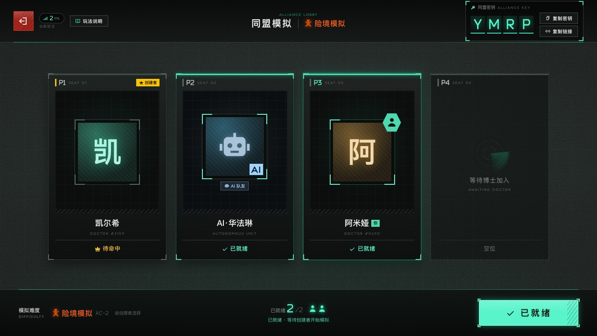
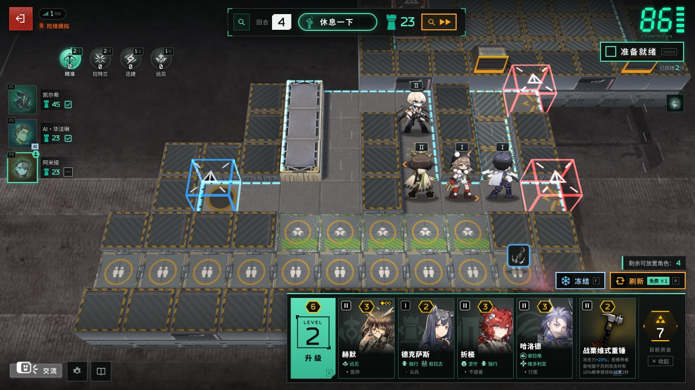
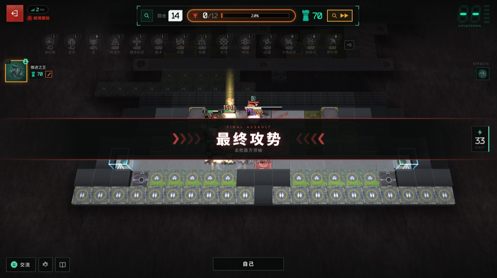

# 卫戍协议：盟约 · Stronghold Protocol: Alliance

本仓库为 [sganggs/Stronghold-Protocol](https://github.com/sganggs/Stronghold-Protocol) 0.2.2 的扩展版本，加入萨卡兹、哥伦比亚干员与盟约，以及薪火集结、拓界研发、斐尔迪南等特色分队。当前包含 **43支分队、25种盟约、11张官方3D地图**，并为126名正式角色提供194款额外皮肤。扩展规则见 [本分支说明](docs/LOCAL-EXPANSION.md)。

本仓库已附带游戏素材、字体、前端库和生产运行依赖。安装 **Node.js 22+** 后，克隆即可启动，无需 `npm install`、本地游戏客户端或另行下载素材。首次获取建议使用下方的浅克隆命令，减少历史版本下载。

《明日方舟》季节性自走棋塔防玩法「卫戍协议：盟约」的**非官方同人复刻**：浏览器即开即玩，单人或 1–4 人联机合作。


## 声明

> [!IMPORTANT]
> - 本项目是玩家自制的**非官方同人作品**，与上海鹰角网络科技有限公司（Hypergryph）、Yostar 及其关联方**没有任何关系**，未获其授权或认可。
> - 《明日方舟》及「卫戍协议」相关的名称、角色、美术、音乐、音效、文本与数据等素材，版权归原权利人所有。这些素材**不适用**本项目的 GPL-3.0 许可证；GPL 只覆盖本项目自己编写的代码。
> - 仅供学习交流与个人非商业使用。**严禁任何形式的盈利**，包括但不限于：售卖本项目或整合包、付费下载或付费分发、收费服务器或收费代开、广告 / 打赏 / 会员等变现方式，以及其他任何商业用途。
> - 本分支为方便克隆后运行，附带下载的游戏美术、模型、音频与字体；素材与游戏数据同样不适用 GPL。请勿将素材用于本项目以外的用途或单独再分发。完整条款见 [NOTICE.md](NOTICE.md)。
> - 权利人如认为本项目侵犯其权益，请通过 Issue 联系，我们会**立即删除**相关内容。
> - 本项目按「现状」提供，**不提供任何担保**，使用风险自负。

English summary: [below](#english).

| 同盟房间 | 策略轮选 | 休整期（商店 / 盟约） |
|---|---|---|
|  |  |  |
| **部署方向轮盘** | **作战** | **最终攻势** |
|  |  |  |

## 目录

- [声明](#声明) · [简介](#简介) · [功能一览](#功能一览)
- [快速开始](#快速开始)：[克隆启动](#克隆后直接运行) · [更新已有克隆](#更新已有克隆) · [可选本地素材](#可选本地素材) · [系统要求](#系统要求) · [端口与配置](#端口与配置) · [局域网联机](#和朋友一起玩局域网)
- [联机方式](#联机方式) · [操作](#操作) · [文档](#文档) · [开发与测试](#开发与测试) · [项目结构](#项目结构)
- [许可证](#许可证) · [致谢与数据来源](#致谢与数据来源) · [贡献](#贡献)

## 简介

「卫戍协议：盟约」是自走棋 + 塔防：休整期在调度中心招募干员、摆阵、配装备，作战期干员自动部署，迎击从红门涌来的敌人，漏过去的敌人扣目标生命值。本项目在浏览器里复刻了这一玩法，规则和数值尽量对照官方数据表与 PRTS 核对。

- **独立模拟**（单人）与**同盟模拟**（1–4 人**合作**，没有 PvP；空位可以加 AI 队友）。
- 服务器是一个 Node.js 程序，**战斗在各玩家的浏览器里模拟**（和官方一样），服务器只管经济与回合，一台低功耗小主机就能开服。
- 基础版本0.2.2支持逐人设置潜能与练度（默认满潜、精英2 Lv.60）、日文语音、统计页及失衡等战斗规则；基础更新见 [CHANGELOG.md](CHANGELOG.md)。本分支近期补充了地图材质、模型动画与显示修复、正式棋子皮肤和动作选择，详见下方功能与文档入口。

## 功能一览

- **完整的一局**：确认本局信息 → 策略轮选（43支分队，含萨卡兹、哥伦比亚检索分队与斐尔迪南分队）→ 14回合 → 结算称号；险境及以上满足条件时进入第15回合「隐秘核心」。
- **4 种可选难度**：险境 / 绝境 / 终极 / 天灾，独立与同盟均可选择。天灾在终极基础上强化第14、15回合全部敌人（生命×100、攻击与防御×10、法抗×3、95%减伤），并将五本、六本棋子卡池数量翻倍，见[天灾说明](docs/design/catastrophe.md)。
- **休整期**：招募、刷新、冻结、升级调度中心；整备区与临时整备区；从整备区拖到棋盘部署，用**方向轮盘**选择朝向。同盟模拟的卡池共用。
- **晋升精锐**：3 名同名干员自动合成精锐，并获得一次高一阶的免费招募。
- **干员与调配**：正式棋子及其精锐、补位与自选干员，包含本分支扩展角色；开局前可配置技能、精锐模组、潜能与练度。实际招募名单随模式、本局禁用和获得条件变化。
- **盟约与层数**：25种盟约，包含萨卡兹、哥伦比亚核心盟约；层数整局保留，每个盟约最多999层。大厅、等待室可打开**盟约图鉴**，开局前查看效果、激活门槛与成员。
- **皮肤与动作**：126名正式角色共194款额外皮肤，另有128名角色的默认基建动作。干员详情可逐人选择皮肤、开关动作，预览正面、背面及可用基建动作；普通与精锐共享外观选择。外观选择不改变伤害和出手时间，完整覆盖名单见 [皮肤与动作说明](docs/remaining-skins-draft.md)。
- **装备与机变**：装备与法术，同名装备合成、特定组合赋予盟约效果；已配发的装备锁定在干员身上。部分回合开始前有机变选卡（装备、资金、干员、层数、悬赏等）。
- **自动作战**：技能按官方「技能策略」自动释放；按接触半径阻挡，阻挡者倒下时由接触的干员接替；元素损伤与元素爆发；召唤物由玩家手动摆放；推开 / 拉拽按力度与重量计算；被击倒的干员留在原地显示再部署倒计时。
- **地形与敌人**：阻隔工事、射击台、源石流吹风机、沼泽、排气格栅、涨潮等地形装置；空中与近地悬浮敌人、悬赏敌人。
- **联防**：有人漏怪、又有人完美作战时，完美作战的队友带着阵容帮忙拦截漏掉的敌人。
- **最终攻势与隐秘核心**：两人共享一个战场，全队共同削减同一条领袖血条；10 个敌方领袖，巨型领袖约 5×3 格的受击范围，以及官方的限伤规则。
- **结算称号**：卫戍之星、不朽盟约、坚若磐石等 6 个称号。
- **断线重连**：同盟模拟断线后 10 分钟内重新打开页面即可回到原座位，掉线期间按原阵容自动作战，也可以「暂离」交给 AI 托管；独立模拟 24 小时内可以回来继续（同一个浏览器）。
- **交互细节**：漏怪时顶栏的目标生命值实时减少（结算时确定）；点选、拖放和配发装备都按地上的方格；购买、升级和机变选卡都需要点两次确认；只有一名玩家时除作战外不计时。
- **画面与声音**：真实Spine小人、官方BGM与音效、表情与作战特效；仓库附带11张官方3D地图及法线、金属/光滑度、自发光材质，无需本地客户端提取。缺少WebGL时支持2D回退；保留自定义中继试验场。
- **显示设置**：可开启“官方伤害数字”和技能“弹药数量”（两项默认关闭），并补充模型动画边界、缓存残影、部署与位移表现修复。详情见 [视觉恢复记录](docs/visual-restoration-migration-draft.md) 与 [地图材质记录](docs/material-restoration-draft.md)。
- **手机与电脑**：触摸拖拽、长按查看详情，推荐横屏；设置里可以调低画质。

## 快速开始

### 克隆后直接运行

安装 [Node.js 22+](https://nodejs.org/zh-cn/download) 和Git，然后执行：

```bash
git clone --depth 1 --branch main https://github.com/KLBSTL/weishu.git
cd weishu
node server/index.js  # 启动服务器：http://localhost:3000（也可 npm start）
```

浏览器打开 **http://localhost:3000** 即可游玩，按 `Ctrl+C` 停止服务器。启动脚本也可使用：Windows双击 `scripts\start-windows.bat`，macOS / Linux运行 `bash scripts/start.sh`，会检查已有文件并打开浏览器。

当前素材约1.2 GB，另附字体、前端库和生产依赖；浅克隆主要减少历史版本下载。普通游玩无需安装Python或开发依赖。仓库地址用于获取程序，启动后使用本机或主机的游戏地址进入。

### 更新已有克隆

停止服务器，在仓库目录执行以下命令，再重新启动：

```bash
git pull --ff-only
node server/index.js
```

有本地代码改动的安装需先处理自己的修改，再合并更新。`node tools/doctor.mjs` 可检查Node版本、素材完整性、端口和局域网地址。部署、服务自启动和维护打包见 [部署指南](docs/DEPLOY.md) 与 [打包说明](docs/WINDOWS.md)。

### 可选本地素材

仓库已附带11张官方3D地图及必要材质，常规运行不需要《明日方舟》客户端。可选提取用于补充部分界面、敌人和召唤物的专用模型，或提供本机覆盖素材；缺少这些覆盖时仍可使用仓库现有资源或替代表现。提取工具和Python依赖只在需要该功能时使用，详见 [素材说明](docs/ASSETS.md) 与 [部署指南](docs/DEPLOY.md)。

### 系统要求

表情和「玩法说明」的教程图也已附带。可选本地覆盖素材需与当前版本一致。

| 项目 | 要求 |
|---|---|
| 开服的电脑 | Windows / macOS / Linux，Node.js 22+；素材约1.2 GB，另需运行依赖和Git历史空间。服务器内存占用取决于房间数量与战斗模拟配置 |
| 玩家 | 支持WebGL的现代浏览器（Chrome / Edge / Firefox / Safari），电脑、手机或平板，推荐横屏 |
| 网络 | 玩家浏览器按使用的地图和干员从主机加载素材，之后使用浏览器缓存；联机玩家无需各自克隆仓库 |

显卡较弱时可以在「设置」里调低画质，或在网址后加 `?board=2d`（强制 2D 棋盘）/ `?render=fallback`（不用 WebGL 的简化画面）。

### 端口与配置

默认监听 **TCP 3000**。换端口：启动脚本加 `--port 3001`，或设置环境变量 `PORT`。

| 环境变量 | 默认 | 说明 |
|---|---|---|
| `PORT` | `3000` | 监听端口 |
| `HOST` | `::` | 监听地址。默认 `::` 是双栈：同一个端口同时接受 IPv6 和 IPv4；`0.0.0.0` = 只 IPv4；`127.0.0.1` = 只允许本机，放在反向代理后面时使用 |
| `SP_COMBAT` | `client` | `client`：各玩家浏览器模拟自己的战斗（服务器负载极低）；`server`：由服务器模拟并推流 |
| `SP_VERIFY` | `off` | 服务器复算客户端上报的战斗结果：`off` / `sample`（约 1/8 抽查）/ `all`（全部复算，更耗 CPU） |
| `TRUST_PROXY` | `auto` | 是否信任 `X-Forwarded-For` 等转发头：`auto` 只信任来自本机 / 内网的代理；`1` 总是；`0` 从不 |
| `DEBUG` | 空 | 设为任意值输出详细日志 |
| `SP_NO_BROWSER` | 空 | 设为 `1` 时启动脚本不自动打开浏览器 |

设置方式：macOS / Linux `PORT=8080 npm start`；PowerShell `$env:PORT=8080; npm start`；cmd `set "PORT=8080" && npm start`。健康检查：`GET /healthz`。

### 和朋友一起玩（局域网）

1. 打开页面 → 输入昵称 → **同盟模拟** → 创建房间。房主选择难度，可以添加 / 移除 AI 队友；开始前也可以把其他博士移出房间（对方可凭密钥重新加入）。
2. 把 4 位字母的**同盟密钥**，或「复制链接」得到的 `http://<地址>:3000/?room=密钥` 发给朋友。
3. 所有人点「准备就绪」后房主开始。
4. 同一 Wi-Fi / 路由器下的朋友打开启动窗口里列出的地址（形如 `http://192.168.x.x:3000`）即可。打不开时多半是防火墙：Windows 首次启动时在弹窗中允许「专用网络」，或运行 `npm run doctor` 查看具体命令；访客 Wi-Fi 常开启「AP 隔离」，也会导致连不上。

刷新页面或断线后，同盟模拟 10 分钟内、独立模拟 24 小时内重新打开即可回到原座位。服务器把房间和对局都保存在内存里，**重启服务器会结束所有对局**。

## 联机方式

朋友不在同一个局域网时，下面是几类常见做法，按自己的情况选一种即可。这里只做简单介绍，提到的工具和服务只是举例，本项目与它们没有任何关系，也不做推荐；具体的安装、费用和使用规则请以各自的官方说明为准。部署细节（防火墙、开机自启、反向代理与 HTTPS、Docker）见 **[docs/DEPLOY.md](docs/DEPLOY.md)**。

| 方式 | 怎么做 | 适合 |
|---|---|---|
| **同一局域网直连** | 把启动窗口里的局域网地址发给朋友 | 同一个家、宿舍或网吧 |
| **组网工具（虚拟局域网）** | 例如 Tailscale、ZeroTier、EasyTier、蒲公英：开服的人和朋友都安装同一个工具并加入同一个网络，朋友用开服电脑的虚拟 IP 访问 `http://<虚拟 IP>:3000` | 固定的几个熟人；不暴露到公网。朋友也要装客户端，部分工具需要注册账号；跨地区时可能走中继而变慢 |
| **内网穿透 / 隧道** | 只有开服的人运行客户端，朋友直接打开网址。例如自建的 frp（需要一台有公网 IP 的服务器）、Cloudflare 的 `cloudflared tunnel --url http://localhost:3000`（临时地址，每次启动都会变；国内访问延迟可能较高）、国内的樱花 frp 一类公共穿透服务（通常需要实名，大陆节点承载网页可能有备案要求） | 不想改路由器、没有公网 IP；免费线路带宽小时，首次加载素材会慢一些 |
| **云服务器 / VPS 直接部署** | 在 VPS 上运行整合包，或用仓库自带的 `Dockerfile`；用 Caddy / Nginx 加上 HTTPS。选离玩家近、线路好的地区（面向大陆玩家时，境外机房要关注回程线路，否则晚高峰延迟可能很高；大陆服务器绑定域名需要 ICP 备案） | 想长期开服、玩家分布在不同地区 |

通用注意事项：

- 游戏是**单个常驻 Node.js 进程 + WebSocket**（路径 `/ws`），只能跑一个实例，必须部署在域名根路径；Vercel 之类的 Serverless 平台和 GitHub Pages 之类的静态托管都不适用。反向代理要转发 WebSocket 升级。
- 游戏没有账号系统，**知道地址的人都能进来**。请只把地址发给朋友，不要公开发布，也不要搭建公开大厅；这同时能降低素材版权方面的风险。
- 有公网 IPv4 时也可以在路由器上做端口转发，但这会把家里的电脑直接暴露在公网上，优先考虑上面的方式。

## 操作

| 操作 | 方法 |
|---|---|
| 购买 / 升级调度中心 / 机变选卡 | 点一次选中，再点一次确认（`D` 升级） |
| 部署 / 移动干员 | 从整备区拖到棋盘格 → 出现方向轮盘 → 往上 / 右 / 下 / 左滑动选择朝向后松手；松在中心或点「✕ 点击取消」取消。拖动时指针 / 手指所在的格子就是落点，能放下时模型直接站在这一格上（不能放下时跟在指针下） |
| 调整朝向 | 把干员拖回它自己的格子，再选方向 |
| 出售 / 撤退 / 销毁装备 | 点击单位所在的格子 → 底部按钮「出售 +1」「撤退」；也可以把棋盘上的干员拖回整备区撤退。整备区里的装备与法术只能「销毁」，已配发的装备锁定在干员身上（干员出售或合成精锐时退回整备区） |
| 装备 | 把装备拖到干员所在的格子上（每人 2 件；满了会弹出替换窗口，被替换的一件会被销毁）；法术拖到地块上并选方向 |
| 查看详情 | 右键或长按单位 / 卡牌（属性为实时数值，高于基础值为绿色、低于为红色） |
| 快捷键 | `R` 刷新 · `F` 冻结 · `D` 升级 · `Q` 撤退 / `X` 出售选中的干员 · `Space` 准备就绪 · `Esc` 取消 / 关闭；除 `Esc` 外都可以在「设置 → 快捷键」里改成别的键（[玩法指南 §11](docs/PLAYING.md#11-快捷键)） |
| 方向轮盘键盘操作 | 方向键预览 · `Enter` 确认 · `Esc` 取消 |
| 暂停（独立模拟） | 作战中（含最终攻势 / 隐秘核心）点顶栏的「暂停」或按 `Space`，再点「继续作战」（或 `Space`）继续；同盟模拟的作战不能暂停 |
| 表情 | 左下角「交流」，左右滑动（或方向键）换主题，冷却 1 秒 |
| 观战 | 自己的作战结束后（或休整期）点左侧队友头像 →「前往查看」；不参战的朋友可以在大厅输入同盟密钥点「观战」（每个同盟最多 2 名观战者，本作新增） |
| 统计（本机） | 标题画面右上角、大厅、等待室的「统计」：胜率、策略通过率、称号、战斗累计和对局记录（点一行回看结算页）；只存在本机浏览器里，可以导出 / 导入，没清完第一个回合就退出的对局不计入统计（[玩法指南 §12](docs/PLAYING.md#13-统计本机)） |

完整的规则、数值和小技巧见 **[docs/PLAYING.md](docs/PLAYING.md)**（游戏内左下角也有「玩法说明」）。

## 文档

| 文档 | 内容 |
|---|---|
| [本分支说明](docs/LOCAL-EXPANSION.md) | 扩展规则、克隆运行与已发布内容的验证记录 |
| [正式棋子皮肤与动作](docs/remaining-skins-draft.md) | 皮肤覆盖名单、动作选择、素材来源与实际渲染验证 |
| [视觉恢复](docs/visual-restoration-migration-draft.md) / [地图材质](docs/material-restoration-draft.md) | 官方地图、显示与动画修复、材质支持范围和已知限制 |
| [CHANGELOG.md](CHANGELOG.md) | 更新记录：每个版本修复了什么、哪些反馈经核实不是问题 |
| [docs/PLAYING.md](docs/PLAYING.md) | 玩法指南：流程、经济、招募与晋升、摆阵、联防、盟约、最终攻势、结算称号 |
| [docs/DEPLOY.md](docs/DEPLOY.md) | 部署指南：Windows 开服与开机自启、防火墙、组网 / 隧道、反向代理与 HTTPS、Docker、systemd、排错 |
| [docs/WINDOWS.md](docs/WINDOWS.md) | Windows 便携包：怎么打一份「零安装」包（`scripts/make-windows-bundle.mjs`）、包里放了什么、授权注意事项 |
| [docs/DESIGN.md](docs/DESIGN.md) | 架构与契约（英文）：索引，按章节号找到文件；现行规则在 `docs/design/`（范围与目录分工、坐标与时间、战斗引擎、对局、网络协议、渲染与 UI），各次试玩和各版本的规则修订与依据在 `docs/history/` |
| [docs/ARCHITECTURE.md](docs/ARCHITECTURE.md) | 代码地图（英文）：服务器、联机协议和前后端共用的战斗模拟，0.2.0 重构后的目录，数据流，黄金结果与导入边界，常见改动从哪里入手 |
| [CONTRIBUTING.md](CONTRIBUTING.md) | 参与贡献：准备环境、运行测试、忠实原则、提交与 PR 约定、怎样添加自选干员（中文，末尾附英文摘要） |
| [docs/SIM.md](docs/SIM.md) | 战斗模拟引擎参考（英文）：钩子、技能描述格式、职业默认行为 |
| [docs/META.md](docs/META.md) | 对局与经济引擎（英文）：回合流程、商店、联防、最终攻势的实现细节 |
| [docs/DATA.md](docs/DATA.md) | 由官方数据表生成的游戏数据（英文） |
| [docs/ASSETS.md](docs/ASSETS.md) | 素材来源、目录结构与清单（英文） |
| [docs/I18N.md](docs/I18N.md) | 界面语言（英文）：界面文字、游戏文本与服务器消息怎样翻译，覆盖范围；**添加一种语言只需在 `public/i18n/` 放一个语言文件**（社区翻译步骤见「Adding a language」，内容包格式见 [docs/PACKS.md](docs/PACKS.md)） |
| [docs/BALANCE.md](docs/BALANCE.md) | 难度模型与测量（英文） |
| [docs/research/](docs/research/00-INDEX.md) | 官方规则、数据与界面的调研记录 |

## 开发与测试

```bash
npm ci                      # 开发与测试所需依赖；普通游玩无需执行
npm run dev                 # node --watch：改动服务器代码后自动重启
node --test                 # 单元与集成测试；浏览器用例按下方开关启用
SP_E2E=1 node --test test/ui/mock.e2e.test.js        # 浏览器端到端测试，需要本机 Chrome（CHROME_PATH 可指定路径）
SP_REAL_E2E=1 node --test test/ui/real.e2e.test.js   # 需要 Chrome + 已下载的素材
RENDER_E2E=1 node --test 'test/render/*.browser.test.js'   # 渲染测试，需要 Chrome；可选本地提取用例按条件跳过
GOLDEN_FULL=1 node --test test/golden.test.js           # 黄金结果：固定种子的整套战斗与人机对局摘要（默认只跑快速子集）
node tools/perfbench.mjs --cpu 1,4,6 --profile             # 真实战斗的帧耗时基准（Chrome 降速 CPU 近似中低端手机），需要 Chrome + 已下载的素材
```

以上环境变量是shell简写；PowerShell可先设置 `$env:RENDER_E2E='1'` 等，再运行对应的 `node --test` 命令。场景素材和皮肤清单分别由 `node tools/build-board-art.mjs`、`node tools/build-skins.mjs` 生成。

- 游戏数据由 `npm run build-data`（`tools/build-data.mjs`）从官方数据表生成，不要手工修改 `data/*.json`。
- 性能测试：`/dev/battle-perf.html` 在浏览器里跑一场真实战斗（对局用的战斗运行器、模拟和渲染），实时显示帧率与逐帧耗时；在手机上打开后点击「开始测量（10 秒）」，生成的报告可以复制后附在反馈中。用到的战斗来自 `node tools/capture-specs.mjs` 从固定种子的机器人对局里截取的数据（`public/dev/perf/`）。
- 只重构、不改玩法的提交不能改变 `test/golden/*.json`；有意改变玩法时运行 `npm run golden:update`，检查差异后随改动一起提交（见 [test/golden/README.md](test/golden/README.md)）。
- GitHub Actions（[.github/workflows/ci.yml](.github/workflows/ci.yml)）在 Ubuntu 与 Windows、Node 22 / 24 上运行 `npm ci`、`node --test` 和服务器冒烟测试。
- 代码怎么分层、改某个规则该从哪个文件入手，见 [docs/ARCHITECTURE.md](docs/ARCHITECTURE.md)。

## 项目结构

| 路径 | 内容 |
|---|---|
| `server/` | 入口 `index.js`；Node HTTP 静态服务 + WebSocket（`/ws`，代码在 `http/`）、大厅、对局引擎（`match/`）、战斗模拟（`sim/`，浏览器与服务器共用） |
| `shared/` | 前后端共用的常量与网络协议 |
| `public/` | 浏览器客户端（原生 ES 模块，PixiJS + pixi-spine、three.js 3D 棋盘、Preact + htm UI） |
| `data/` | 由官方数据表生成的游戏数据与素材清单 `assets.json` |
| `tools/` | `setup.mjs` / `doctor.mjs`、素材下载 `fetch-assets.mjs`、数据构建、本地提取 `local-extract/` |
| `scripts/` | 启动脚本（Windows / macOS / Linux）、Windows 开机自启 |
| `docs/` | 文档与调研 |
| `test/` | `node:test` 测试 |

## 许可证

- **代码**：本项目自己编写的代码以 **GPL-3.0-or-later** 发布，全文见 [LICENSE](LICENSE)；另附一条 GPL 第 7 条的附加许可，允许与 pixi-spine 中的 Spine Runtimes 组合分发（见 [NOTICE.md](NOTICE.md)）。
- **游戏素材不在许可范围内**：《明日方舟》相关的美术、音乐、音效、文本与数据等版权归原权利人所有，不适用 GPL，使用限制见上方的[声明](#声明)和 [NOTICE.md](NOTICE.md)。
- **第三方组件**各自遵循其许可证：通过 npm 安装的库（整合包的 `node_modules` 中附带各自的许可证文件）、`tools/local-extract/aklz4.py` 的算法（BSD-3-Clause），以及字体等，清单与许可证全文见 [THIRD-PARTY-NOTICES.md](THIRD-PARTY-NOTICES.md)。

## 致谢与数据来源

- 游戏数据：[Kengxxiao/ArknightsGameData](https://github.com/Kengxxiao/ArknightsGameData)。
- 素材来源：[yuanyan3060/ArknightsGameResource](https://github.com/yuanyan3060/ArknightsGameResource)、[fexli/ArknightsResource](https://github.com/fexli/ArknightsResource)、[isHarryh/Ark-Models](https://github.com/isHarryh/Ark-Models)、[ArknightsAssets/ArknightsAssets2](https://github.com/ArknightsAssets/ArknightsAssets2)；字体来自 [TimWangZi/The-font-of-Arknights](https://github.com/TimWangZi/The-font-of-Arknights) 与 Google Fonts（Noto Sans SC）。详见 [docs/ASSETS.md](docs/ASSETS.md)。
- 规则核对参考：[PRTS 明日方舟中文 Wiki](https://prts.wiki/)。
- LZ4AK 解包：`tools/local-extract/aklz4.py` 的算法来自 [isHarryh/Ark-Unpacker](https://github.com/isHarryh/Ark-Unpacker)（BSD-3-Clause，经 MooncellWiki/UnityPy）；解析 Unity 资源使用 [UnityPy](https://github.com/K0lb3/UnityPy)（MIT）。
- 库：[PixiJS](https://pixijs.com/)（MIT）、[pixi-spine](https://github.com/pixijs/spine)（MIT；其中包含的 Spine Runtime 另受 [Spine Runtimes License](https://esotericsoftware.com/spine-runtimes-license) 约束）、[three.js](https://threejs.org/)（MIT）、[Preact](https://preactjs.com/) + [htm](https://github.com/developit/htm)（MIT）、[ws](https://github.com/websockets/ws)（MIT）。

感谢以上项目的作者与维护者，以及鹰角网络带来的这款游戏。

## 贡献

欢迎提 Issue 反馈 bug、与官方规则不一致的地方或改进建议，也欢迎提交 Pull Request：

- 准备环境、运行测试、忠实原则和提交约定见 [CONTRIBUTING.md](CONTRIBUTING.md)。
- 提交前请运行 `node --test`，并同步更新相关文档；文档使用简体中文，代码与注释使用英文。
- 提交的代码将以 GPL-3.0-or-later 发布。
- 本分支按维护者要求附带运行素材与生产依赖；更新时保留第三方声明，勿提交机器配置、缓存或开发依赖。见 [本分支说明](docs/LOCAL-EXPANSION.md)。
- 本项目坚持非商业：请不要提交广告、付费、打赏等任何形式的变现功能。

---

## English

An **unofficial, non-commercial fan remake** of Arknights' seasonal auto-chess tower-defense mode *Stronghold Protocol: Alliance*, played in the browser: solo, or 1–4 player co-op (AI teammates can fill seats). Combat is simulated in each player's browser, so a low-power PC can host.

- **Run this fork:** install Node.js 22+ and Git, run `git clone --depth 1 --branch main https://github.com/KLBSTL/weishu.git`, enter `weishu`, then run `node server/index.js` and open <http://localhost:3000>. Art, fonts, browser libraries and production dependencies are included; playing needs no `npm install` or separate asset download. Assets currently total about 1.2 GB, plus dependencies and Git history. Windows users can double-click `scripts/start-windows.bat`; macOS/Linux users can run `bash scripts/start.sh`. Developers use `npm ci` for development dependencies.
- **This fork's features:** 43 squads and 25 alliances, including the Sarkaz/Columbia expansions and Ferdinand's power-armour squad; 11 official 3D maps with normal, metallic/smoothness and emission textures; 194 extra costumes for 126 formal operators and default Base actions for 128 operators. Select costumes and animation playback in operator details; browse alliance effects before starting a match. The official damage-number style and ammo counts are optional settings, both off by default.
- **Optional local extraction:** the included maps work without an Arknights client. Extraction can provide additional UI/enemy/summon assets or local overrides; 2D and model fallbacks remain available. Scope and limitations: [assets](docs/ASSETS.md), [skins/actions](docs/remaining-skins-draft.md) and [scene materials](docs/material-restoration-draft.md).
- **Languages:** Chinese (the default), English, 日本語, 한국어 and 繁體中文 — switch on the title screen or in Settings. Game texts come from the official clients; the Japanese, Korean and Traditional Chinese interface strings are machine translations (corrections welcome: [docs/I18N.md](docs/I18N.md)).
- **Play with friends:** create a co-op room and share the 4-letter key or the `?room=KEY` link. On a LAN, use the address printed at start; otherwise use a virtual-LAN tool, a tunnel or a VPS — see [docs/DEPLOY.md](docs/DEPLOY.md).
- **Disclaimer:** not affiliated with or endorsed by Hypergryph or Yostar. All Arknights names, art, audio, text and data are © their respective owners and are **not** covered by this project's GPL licence. For study and personal non-commercial use only — no selling, paid distribution, paid servers or monetisation of any kind. Content will be removed on request of the rights holders. Provided "as is", without warranty.
- **License:** code GPL-3.0-or-later ([LICENSE](LICENSE)); game assets excluded.
- **Contributing:** [CONTRIBUTING.md](CONTRIBUTING.md) (an English summary at its end); the code map is [docs/ARCHITECTURE.md](docs/ARCHITECTURE.md).
